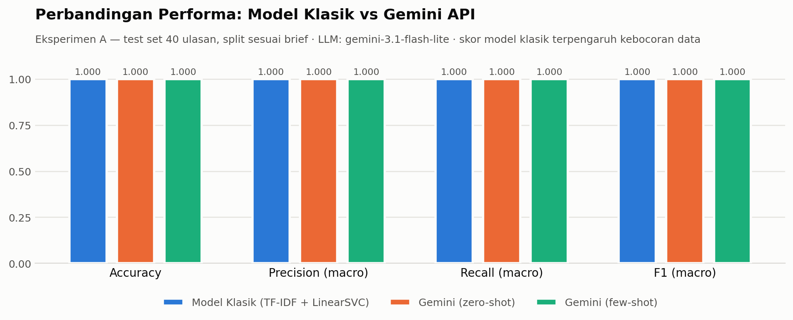
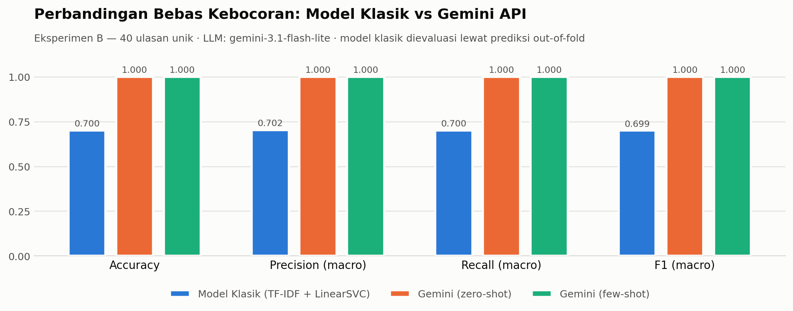

# AI Model Experiment & Evaluation — Sentiment Analysis Ulasan Pelanggan

Eksperimen perbandingan dua pendekatan AI untuk klasifikasi sentimen ulasan pelanggan e-commerce:
**model klasik Machine Learning** (Scikit-learn) versus **Large Language Model via API** (Gemini).

> **Ringkasan temuan.** Pada split yang ditentukan brief, kedua pendekatan memperoleh skor sempurna
> 1.0000 — tetapi hasil itu tidak bermakna, karena 97,5% ulasan test ternyata memiliki salinan persis
> di training set. Setelah kebocoran data dihilangkan, **F1 macro model klasik turun ke 0.6992
> sementara Gemini bertahan di 1.0000**. Rekomendasi: kembangkan pendekatan **Gemini API zero-shot**.

---

## Daftar Isi

- [1. Problem Statement](#1-problem-statement)
- [2. Dataset](#2-dataset)
- [3. Ringkasan Eksperimen](#3-ringkasan-eksperimen)
- [4. Hasil Evaluasi dan Perbandingan](#4-hasil-evaluasi-dan-perbandingan)
- [5. Analisis Trade-off](#5-analisis-trade-off)
- [6. Limitation](#6-limitation)
- [7. Rekomendasi Technical Approach](#7-rekomendasi-technical-approach)
- [8. Cara Menjalankan](#8-cara-menjalankan)
- [9. Struktur Project](#9-struktur-project)

---

## 1. Problem Statement

### Objective

Tim produk e-commerce ingin membangun fitur otomatis yang mengklasifikasikan sentimen ulasan
pelanggan pada halaman produk. Tujuan eksperimen ini bukan membangun sistem produksi, melainkan
menjawab satu pertanyaan keputusan:

> Pendekatan mana — melatih model klasik sendiri, atau memanggil LLM API dengan prompt — yang
> sebaiknya dikembangkan lebih lanjut untuk use case ini?

Jawabannya harus didukung bukti kuantitatif pada test set yang sama, serta analisis trade-off dari
sisi effort implementasi, kecepatan, dan biaya.

### Target / Label yang Diprediksi

Binary text classification. Untuk setiap ulasan (`review_text`), diprediksi satu dari dua label:

| Label | Arti | Contoh dari dataset |
|---|---|---|
| `positif` | Pelanggan puas terhadap produk, pengiriman, atau pelayanan | *"Barangnya bagus banget, sesuai foto dan pengiriman cepat!"* |
| `negatif` | Pelanggan kecewa terhadap produk, pengiriman, atau pelayanan | *"Kualitas produk jelek, baru dipakai sekali sudah rusak."* |

Tidak ada kelas `netral` dalam dataset.

**Kelas `negatif` adalah yang terpenting secara bisnis.** Ulasan negatif adalah sinyal yang dapat
ditindaklanjuti (eskalasi ke CS, audit seller, penarikan listing), sementara ulasan positif umumnya
tidak menuntut aksi. Karena itu laporan ini menyoroti **recall kelas `negatif`** — berapa persen
keluhan nyata yang berhasil tertangkap — di samping metrik macro-average.

### Batasan dan Asumsi

**Batasan:**

- Hanya dataset `data/customer_reviews_sentiment.csv` yang digunakan; **file asli tidak dimodifikasi**.
- Split mengikuti starter notebook persis: `test_size=0.2`, `random_state=42`, `stratify=y`.
- **Test set yang sama** digunakan untuk kedua pendekatan.
- Tanpa training Deep Learning dari nol, dan tanpa fine-tuning LLM (Pendekatan 2 murni prompting).

**Asumsi:**

- Label dataset dianggap ground truth, meskipun proses anotasinya tidak diketahui.
- Setiap ulasan memiliki satu sentimen dominan yang dapat diwakili satu label.
- Distribusi dataset dianggap mewakili ulasan produksi — asumsi ini **diperiksa dan sebagian
  terbantahkan** (lihat [Limitation](#6-limitation)).
- Biaya API diestimasi dari token yang benar-benar terpakai, bukan asumsi panjang teks.

---

## 2. Dataset

`data/customer_reviews_sentiment.csv` — 200 ulasan pelanggan e-commerce berbahasa Indonesia.

| Properti | Nilai |
|---|---|
| Jumlah baris | 200 |
| Kolom | `review_id`, `product_name`, `review_text`, `sentiment` |
| Distribusi label | 110 `positif` (55%) / 90 `negatif` (45%) — rasio 1,22 : 1 |
| Missing value | Tidak ada |
| Panjang ulasan | min 6, median 8, maks 11 kata |
| Nama produk unik | 15 |
| **Teks ulasan unik** | **40 dari 200 baris (80% duplikat)** |

### Temuan Kritis: Duplikasi Menyebabkan Kebocoran Data

Dataset hanya memuat **40 teks ulasan yang benar-benar unik** (20 `positif`, 20 `negatif`), masing-masing
diulang antara 1 sampai 12 kali. Label selalu konsisten untuk teks yang sama.

Konsekuensinya serius: random split menempatkan **39 dari 40 ulasan test (97,5%) sebagai salinan persis
dari ulasan yang ada di training set**. Model klasik tidak perlu belajar menggeneralisasi bahasa —
cukup menghafal. Pendekatan LLM tidak terpengaruh, karena Gemini tidak pernah melihat training set.

Melaporkan hanya angka dari split yang ditentukan akan **menguntungkan model klasik secara tidak adil**.
Karena itu eksperimen dijalankan dua kali.

---

## 3. Ringkasan Eksperimen

### Dua Eksperimen

| | **Eksperimen A** (utama, sesuai brief) | **Eksperimen B** (tambahan) |
|---|---|---|
| Data | 200 baris | 40 teks unik (deduplikasi) |
| Split | `test_size=0.2, random_state=42, stratify=y` → 160 train / 40 test | 5-fold CV, prediksi out-of-fold |
| Kebocoran | Ada (97,5%) | Tidak ada |
| Peran | Deliverable resmi yang diminta brief | Estimasi generalisasi yang jujur |

Eksperimen B menilai **ketiga pendekatan pada 40 item identik**, tanpa ada yang pernah melihat
jawabannya lebih dulu.

### Pendekatan 1 — Model Klasik (Scikit-learn)

- **Preprocessing:** `TfidfVectorizer()` pada teks mentah (lowercasing + tokenisasi internal).
  Menghasilkan 145 token unik. Stopword removal Indonesia **sengaja tidak diterapkan** — pada teks
  sependek ini, negasi seperti *"tidak sesuai"* justru membawa sinyal sentimen dan akan rusak jika
  *"tidak"* dibuang.
- **Pemilihan model:** tiga kandidat dibandingkan lewat **5-fold CV pada training set saja** (test set
  tidak disentuh, agar skor test tetap valid sebagai estimasi tak bias):

  | Model | CV F1 macro | Std |
  |---|---|---|
  | **LinearSVC** (terpilih) | **1.0000** | 0.0000 |
  | LogisticRegression | 0.9681 | 0.0404 |
  | MultinomialNB | 0.9678 | 0.0502 |

- **Waktu training:** ~0,001 detik untuk 160 ulasan.

### Pendekatan 2 — LLM API (Gemini)

- **Model:** `gemini-3.1-flash-lite`.

  > ⚠️ **Catatan penting:** model `gemini-2.0-flash` yang tertulis di starter notebook **sudah
  > dipensiunkan** dan mengembalikan HTTP 404; `gemini-2.5-flash` tidak lagi dibuka untuk user baru.
  > Notebook ini memakai daftar kandidat model dengan fallback otomatis, sehingga tetap berjalan tanpa
  > error meskipun katalog model Google berubah lagi.

- **Dua strategi prompting diuji:** zero-shot dan few-shot (4 contoh berlabel).
- **Contoh few-shot ditulis manual, tidak diambil dari dataset** — mengambil contoh dari dataset akan
  membocorkan data evaluasi ke dalam prompt pada Eksperimen B. Dua dari empat contoh sengaja berupa
  ulasan campuran, untuk mendemonstrasikan aturan penilaian kesan keseluruhan.
- **Efisiensi:** karena hanya ada 40 teks unik, prediksi dijalankan pada teks unik lalu dipetakan ke
  test set — total **80 panggilan API** untuk kedua strategi sekaligus, melayani kedua eksperimen.

#### Parameter Generasi dan Alasannya

| Parameter | Nilai | Alasan |
|---|---|---|
| `temperature` | **0.0** | Klasifikasi punya satu jawaban benar, bukan task kreatif. Temperature 0 membuat decoding deterministik sehingga **eksperimen reproducible** dan perbandingan dengan model klasik yang deterministik menjadi adil. Starter memakai 0.2; nilai itu diturunkan justru untuk menghilangkan variansi yang tidak diinginkan. |
| `max_output_tokens` | **2000** | Output yang diinginkan hanya satu kata, tetapi model Gemini generasi baru mengalokasikan token untuk reasoning internal; batas terlalu ketat membuat respons terpotong dan `response.text` kosong. |
| `top_p` / `top_k` | default | Pada `temperature=0.0` decoding sudah greedy, sehingga keduanya tidak berpengaruh. |

#### Penanganan Keandalan

- **Normalisasi output** — lowercase, strip tanda baca, cocokkan ke label valid. Output di luar dua
  label ditandai `invalid` dan dihitung terpisah, **bukan diam-diam dipetakan** ke salah satu kelas.
- **Retry + exponential backoff** — beberapa `ServerError` (503) dan `ClientError` benar-benar terjadi
  selama eksperimen dan tertangani otomatis.
- **Caching ke disk** (`results/llm_predictions.csv`) — notebook dapat dijalankan ulang tanpa biaya API
  tambahan dan hasilnya tetap reproducible.

Hasil: **0 dari 80 output gagal dinormalisasi.**

---

## 4. Hasil Evaluasi dan Perbandingan

### Metrik yang Dilaporkan

**Accuracy** mudah dibaca tetapi menyesatkan pada data tidak seimbang — menebak `positif` terus saja
sudah memberi 55%. Karena itu selalu disertai **Precision/Recall/F1 macro-average** (bobot sama per
kelas, sehingga kelas `negatif` yang lebih kecil tidak tertutup mayoritas) dan **recall kelas `negatif`**
sebagai metrik bisnis.

### Eksperimen A — Split Sesuai Brief (test set 40 ulasan)

| Pendekatan | Accuracy | Precision (macro) | Recall (macro) | F1 (macro) | Recall (negatif) | Output invalid |
|---|---|---|---|---|---|---|
| Model Klasik (TF-IDF + LinearSVC) | 1.0000 | 1.0000 | 1.0000 | 1.0000 | 1.0000 | 0 |
| Gemini (zero-shot) | 1.0000 | 1.0000 | 1.0000 | 1.0000 | 1.0000 | 0 |
| Gemini (few-shot) | 1.0000 | 1.0000 | 1.0000 | 1.0000 | 1.0000 | 0 |

**Confusion matrix — ketiga pendekatan identik:**

|  | pred `negatif` | pred `positif` |
|---|---|---|
| **true `negatif`** | 18 | 0 |
| **true `positif`** | 0 | 22 |



> **Interpretasi.** Skor sempurna tiga arah berarti **split ini tidak mampu membedakan kedua
> pendekatan sama sekali**. Penyebabnya: 97,5% ulasan test bocor ke training set, dan kosakata dataset
> sangat terpolarisasi. Jika laporan berhenti di sini, kesimpulannya menjadi "kedua pendekatan sama
> baiknya" — dan kesimpulan itu keliru.

### Eksperimen B — Bebas Kebocoran (40 ulasan unik)

| Pendekatan | Accuracy | Precision (macro) | Recall (macro) | F1 (macro) | Recall (negatif) | Output invalid |
|---|---|---|---|---|---|---|
| Model Klasik (TF-IDF + LinearSVC) | 0.7000 | 0.7020 | 0.7000 | **0.6992** | **0.6500** | 0 |
| **Gemini (zero-shot)** | **1.0000** | **1.0000** | **1.0000** | **1.0000** | **1.0000** | 0 |
| **Gemini (few-shot)** | **1.0000** | **1.0000** | **1.0000** | **1.0000** | **1.0000** | 0 |

**Dampak penghapusan kebocoran terhadap F1 macro:**

| Pendekatan | Eksperimen A | Eksperimen B | Selisih |
|---|---|---|---|
| Model Klasik | 1.0000 | 0.6992 | **−0.3008** |
| Gemini (zero-shot) | 1.0000 | 1.0000 | 0.0000 |
| Gemini (few-shot) | 1.0000 | 1.0000 | 0.0000 |

**Confusion matrix — model klasik (out-of-fold):**

|  | pred `negatif` | pred `positif` |
|---|---|---|
| **true `negatif`** | 13 | 7 |
| **true `positif`** | 5 | 15 |

**Confusion matrix — Gemini (zero-shot & few-shot, identik):**

|  | pred `negatif` | pred `positif` |
|---|---|---|
| **true `negatif`** | 20 | 0 |
| **true `positif`** | 0 | 20 |



> **Interpretasi.** Begitu kebocoran dihilangkan, **F1 model klasik runtuh 30 poin sementara Gemini
> tidak bergerak sama sekali** — bukti langsung bahwa skor sempurna model klasik pada Eksperimen A
> berasal dari hafalan, bukan pemahaman bahasa. Recall `negatif` sebesar 0.65 berarti **lebih dari
> sepertiga keluhan pelanggan tidak terdeteksi**, persis kegagalan yang paling mahal untuk fitur ini.

### Signifikansi Statistik (interval kepercayaan Wilson 95%, n=40)

| Pendekatan | Benar | Accuracy | CI 95% |
|---|---|---|---|
| Model Klasik (out-of-fold) | 28/40 | 0.7000 | [0.5457, 0.8193] |
| Gemini (zero-shot) | 40/40 | 1.0000 | [0.9124, 1.0000] |
| Gemini (few-shot) | 40/40 | 1.0000 | [0.9124, 1.0000] |

Batas bawah CI Gemini (0.912) berada **di atas** batas atas CI model klasik (0.819), sehingga selisih
performa ini signifikan secara statistik, bukan kebetulan sampling.

> **Catatan kejujuran (aturan tiga):** 0 kesalahan dari 40 percobaan masih konsisten dengan tingkat
> error sebenarnya hingga ~7,5%. Skor 100% berarti *"tidak terbantahkan pada 40 item ini"*, **bukan**
> *"pasti sempurna"*.

### Kecepatan dan Biaya (terukur)

| | Model Klasik | Gemini zero-shot | Gemini few-shot |
|---|---|---|---|
| Latency rata-rata / ulasan | ~0,002–0,004 ms | 5.269 ms (5,3 s) | 4.690 ms (4,7 s) |
| Latency p95 | — | 21,6 s | 16,6 s |
| 10.000 ulasan (serial) | < 0,1 detik | 14,6 jam | 13,0 jam |
| Token input rata-rata | — | 132,5 | 243,5 |
| Biaya / 1.000 ulasan | $0,00 | **$0,0141** | $0,0252 |
| Biaya / 100.000 ulasan per bulan | $0,00 | **$1,41** | $2,52 |

*Biaya dihitung dari token terukur × harga publik Gemini Flash-Lite ($0,10 / 1M input, $0,40 / 1M output).*

---

## 5. Analisis Trade-off

### Performa

Pada Eksperimen A **tidak ada pemenang** — ketiganya seri di 1.0000, karena split tersebut tidak mampu
membedakan apa pun. Eksperimen B memberi jawaban sebenarnya: **Gemini unggul 30 poin F1**, dan unggul
telak pada metrik bisnis (recall `negatif` 1.00 vs 0.65).

**Satu kualifikasi penting:** angka 0.70 itu bukan bukti bahwa *"TF-IDF adalah pendekatan buruk"*,
melainkan bukti bahwa *"TF-IDF dengan hanya 32 contoh training per fold adalah pendekatan buruk"*.
Dataset hanya menyediakan 40 teks unik — jauh di bawah kebutuhan model bag-of-words. Kesimpulan yang
jujur: **pada rezim data yang tersedia sekarang**, LLM unggul telak.

### Effort Implementasi (training vs tanpa training)

| Dimensi | Model Klasik | Gemini API |
|---|---|---|
| Data berlabel | **Wajib** — dataset ini hanya 40 teks unik, tidak cukup | Tidak perlu sama sekali |
| Waktu ke prototipe | Pipeline: vectorizer, pemilihan model, CV, tuning | Satu prompt yang dirancang baik |
| Waktu training | ~0,001 detik (akan tumbuh seiring data) | Nol |
| Keahlian | ML engineering | Prompt engineering + penanganan API |
| Perubahan kebutuhan | Label baru + training ulang | Sunting prompt |
| Reproducibility jangka panjang | **Tinggi** — artefak dapat dibekukan | **Rendah** — model API dapat dipensiunkan |

Baris terakhir bukan risiko teoretis melainkan **terbukti**: `gemini-2.0-flash` dari starter notebook
mengembalikan 404, dan `gemini-2.5-flash` menolak user baru. Model klasik yang sudah dilatih tidak akan
menghilang seperti itu.

### Kecepatan

Model klasik lebih cepat **lebih dari satu juta kali lipat**. Selisih sebesar ini biasanya menentukan
keputusan — tetapi di sini **tidak**, karena:

1. **Use case bersifat asinkron** — klasifikasi ulasan tidak berada di jalur kritis page-load.
2. **Latency API dapat diparalelkan** — 14,6 jam adalah angka serial; dengan 20 pekerja paralel,
   10.000 ulasan selesai di bawah satu jam.

Yang lebih perlu diwaspadai adalah **ekor distribusi** (p95 = 21,6 detik) dan kegagalan transien, yang
menuntut antrean, backoff, dan timeout — kompleksitas operasional yang tidak dibutuhkan model klasik.

*Catatan pengukuran:* few-shot tercatat sedikit lebih cepat daripada zero-shot meski promptnya lebih
panjang. Ini hampir pasti noise beban server, bukan efek nyata.

### Biaya

Model klasik gratis secara nominal, tetapi perbandingan itu menyesatkan bila **biaya manusia**
diabaikan. Melatih model klasik yang layak produksi menuntut ribuan ulasan berlabel; melabeli 5.000
ulasan pada 5 detik per ulasan saja menghabiskan **~7 jam kerja manusia** — biaya sekali bayar yang,
pada volume 100.000 ulasan/bulan, setara **biaya API Gemini bertahun-tahun**. Bahkan pada 10 juta
ulasan/bulan, biaya zero-shot hanya ~$141/bulan.

**Pada volume e-commerce realistis, biaya bukan faktor penentu keputusan.**

Satu keputusan biaya yang jelas: **few-shot memakan 84% token input lebih banyak tanpa peningkatan
akurasi sedikit pun** (keduanya 100%, kesepakatan 100%). Pada dataset ini few-shot murni menambah biaya.

---

## 6. Limitation

### A. Keterbatasan dataset (paling menentukan)

- **Hanya 40 teks unik dari 200 baris (80% duplikat)** → kebocoran data membuat Eksperimen A tidak
  mampu membedakan kedua pendekatan.
- **Test set terlalu kecil (40 item)** → nol kesalahan masih konsisten dengan error hingga 7,5%.
- **Ulasan terlalu mudah dan terpolarisasi** — median 8 kata, kosakata sentimen eksplisit, tanpa
  sarkasme, typo, emoji, atau campuran kode bahasa yang rumit. Ulasan nyata jauh lebih berantakan.
- **Tidak ada kelas netral**, padahal banyak ulasan produksi bersifat netral/deskriptif.
- **Efek plafon** — Gemini mencapai 100%, sehingga benchmark ini tidak dapat membedakan zero-shot dari
  few-shot, maupun mengukur seberapa besar keunggulan Gemini sebenarnya.

### B. Keterbatasan model klasik (teramati langsung)

Seluruh **12 kesalahan** pada Eksperimen B berasal dari model klasik, dengan pola yang sangat jelas:

- **Negasi tidak terwakili.** *"Bahan nyaman dipakai, ukuran pas, tidak mengecewakan"* → diprediksi
  `negatif`. Penyebabnya terlihat pada koefisien model: token `tidak` berbobot **−0.832** ke arah
  negatif. Bag-of-words memperlakukan kata sebagai unit independen, sehingga **"tidak mengecewakan"
  tidak dapat dibedakan dari "mengecewakan"**.
- **Out-of-vocabulary.** Kosakata hanya 145 token. *"Pelayanan lambat dan tidak responsif saat
  dikomplain"* → diprediksi `positif` karena kata pembawa sinyalnya absen dari kosakata fold tersebut.
- **Rapuh terhadap bahasa baru.** Slang, nama produk baru, atau typo menuntut pelabelan dan training ulang.

### C. Keterbatasan pendekatan LLM (teramati dan potensial)

- **Model dipensiunkan tanpa peringatan** — terbukti pada `gemini-2.0-flash` (404) dan `gemini-2.5-flash`
  (tertutup untuk user baru). Risiko reproducibility dan kontinuitas produksi yang nyata.
- **Kegagalan transien** — `ServerError` (503) dan `ClientError` terjadi selama 80 panggilan, tertangani
  hanya karena ada retry + backoff.
- **Latency tinggi dan bervariasi** — rata-rata 5,3 detik, p95 21,6 detik.
- **Risiko format output** — 0 kegagalan pada eksperimen ini, tetapi tidak dijamin; produksi tetap wajib
  memvalidasi output dan menyediakan fallback.
- **Data keluar dari infrastruktur sendiri** — ulasan nyata dapat memuat PII (nama, alamat, nomor
  pesanan), menimbulkan pertimbangan privasi yang **tidak ada** pada model klasik lokal.
- **Ketergantungan pihak ketiga** — harga, kuota, dan perilaku model dapat berubah sepihak.
  `temperature=0.0` menjamin determinisme dalam satu versi model, tetapi tidak melindungi dari
  pembaruan model di sisi penyedia.

---

## 7. Rekomendasi Technical Approach

> ### Kembangkan **Pendekatan 2 — Gemini API dengan prompt zero-shot**

Pemilihan **zero-shot, bukan few-shot**, adalah bagian eksplisit dari rekomendasi.

### Alasan

**1. Unggul telak pada satu-satunya evaluasi yang valid.** Pada Eksperimen A ketiganya seri di 1.0000,
tetapi hasil itu tidak bermakna karena kebocoran 97,5%. Pada Eksperimen B yang bebas kebocoran, Gemini
mempertahankan F1 macro 1.0000 sementara model klasik turun ke 0.6992 — selisih yang **signifikan
secara statistik** menurut interval kepercayaan Wilson.

**2. Model klasik gagal tepat pada metrik yang paling penting secara bisnis.** Recall `negatif` hanya
0.65: lebih dari sepertiga keluhan pelanggan lolos tanpa terdeteksi. Untuk fitur yang tujuannya
menangkap ketidakpuasan pelanggan, tingkat kegagalan ini menggagalkan tujuan fitur itu sendiri.

**3. Data berlabel yang tersedia tidak cukup untuk melatih model klasik yang layak.** Dataset hanya
memuat 40 ulasan unik; kegagalan negasi dan OOV yang teramati adalah gejala langsung dari kelaparan
data ini. Gemini tidak membutuhkan data berlabel sama sekali — pendekatan ini **dapat dipakai hari
ini**, sementara model klasik baru bisa dipertimbangkan setelah investasi pelabelan berminggu-minggu.

**4. Biaya bukan faktor penghalang.** $1,41 untuk 100.000 ulasan per bulan; bahkan pada 10 juta ulasan
per bulan hanya ~$141 — jauh lebih murah daripada biaya manusia untuk melabeli data training.

**5. Kelemahan utama LLM tidak mengikat pada use case ini.** Latency 5,3 detik terdengar buruk, tetapi
klasifikasi ulasan berjalan **asinkron** dan dapat diparalelkan.

**6. Zero-shot dipilih karena few-shot tidak memberi manfaat terukur.** Keduanya 100% dengan kesepakatan
100%, tetapi few-shot memakan 84% token input lebih banyak. Few-shot tetap disimpan sebagai alat
cadangan begitu data yang lebih sulit memunculkan pola kesalahan sistematis.

### Batasan Rekomendasi Ini

Rekomendasi ini bersandar pada evaluasi 40 ulasan pendek yang sangat terpolarisasi, dan keduanya
menyentuh plafon pada Eksperimen A. Yang **dibuktikan**: dengan data berlabel yang tersedia sekarang,
LLM jelas lebih unggul. Yang **belum dibuktikan**: bahwa keunggulan itu bertahan pada ulasan produksi
yang panjang, bercampur sentimen, dan mengandung sarkasme. Karena itu langkah nomor 1 di bawah bukan opsional.

### Langkah Selanjutnya

1. **Bangun eval set yang layak sebelum apa pun masuk produksi** — minimal 300–500 ulasan nyata,
   diambil acak, dilabeli dua anotator dengan pengukuran kesepakatan, sengaja memuat kasus sulit
   (campuran, sarkasme, netral, typo, emoji).
2. **Tambahkan kelas `netral`** — label biner memaksa ulasan deskriptif masuk ke salah satu kutub.
3. **Deploy Gemini zero-shot secara asinkron** dengan retry + backoff, validasi output, antrean review
   manual untuk output `invalid`, **cache berbasis hash teks** (dataset ini saja 80% duplikat), serta
   **pinning versi model** disertai pemantauan deprecation.
4. **Catat setiap prediksi beserta teks ulasannya** — dalam beberapa bulan, log ini menjadi dataset
   berlabel besar yang selama ini tidak dimiliki tim.
5. **Evaluasi ulang model klasik secara berkala** — setelah terkumpul ≥2.000 ulasan berlabel nyata.
   Keunggulan 30 poin hari ini sebagian besar konsekuensi kelangkaan data, bukan sifat permanen.
6. **Pertimbangkan arsitektur hybrid saat volume tumbuh** — model klasik menangani kasus berkepercayaan
   tinggi secara instan dan gratis, LLM menangani sisanya yang ambigu.
7. **Tinjau ulang keputusan bila salah satu terpicu:** kebutuhan klasifikasi sinkron (<100 ms), volume
   menembus puluhan juta ulasan/bulan, atau kebijakan privasi yang melarang pengiriman teks pelanggan
   ke API pihak ketiga.

---

## 8. Cara Menjalankan

### Prasyarat

- Python 3.10 atau lebih baru
- API key Gemini — gratis di [aistudio.google.com/apikey](https://aistudio.google.com/apikey)

### Langkah

**1. Clone repository dan masuk ke foldernya**

```bash
git clone <URL_REPOSITORY_INI>
cd model-experiment-assignment
```

**2. Buat virtual environment dan install dependensi**

```bash
python3 -m venv .venv
source .venv/bin/activate        # Windows: .venv\Scripts\activate
pip install -r requirements.txt
```

**3. Siapkan API key**

```bash
cp .env.example .env
```

Buka `.env` dan isi key Anda:

```
GEMINI_API_KEY=your_api_key_here
```

> `.env` sudah terdaftar di `.gitignore`, sehingga key tidak akan ikut ter-commit.

**4. Jalankan notebook**

```bash
jupyter notebook notebook/experiment_notebook.ipynb
```

Lalu jalankan seluruh sel berurutan (*Kernel → Restart & Run All*).

Alternatif tanpa membuka browser:

```bash
jupyter nbconvert --to notebook --execute --inplace notebook/experiment_notebook.ipynb
```

### Catatan Menjalankan

- **Durasi.** Run pertama memerlukan **80 panggilan API** (~7 menit). Prediksi langsung disimpan ke
  `results/llm_predictions.csv`, sehingga **run berikutnya tidak memanggil API sama sekali** dan
  selesai dalam hitungan detik.
- **Ingin memanggil ulang API dari nol?** Hapus file cache-nya:
  ```bash
  rm results/llm_predictions.csv
  ```
- **Biaya.** 80 panggilan pada `gemini-3.1-flash-lite` berada jauh di dalam kuota gratis Google AI Studio.
- **Model tidak tersedia?** Notebook otomatis mencoba daftar kandidat model secara berurutan. Bila
  seluruhnya gagal, sunting `MODEL_CANDIDATES` pada Section 5.1 dengan model yang tersedia untuk akun Anda.
- **Reproducibility.** Seluruh proses acak dikunci pada `random_state=42` dan LLM berjalan pada
  `temperature=0.0`, sehingga hasil dapat direproduksi persis.

---

## 9. Struktur Project

```
model-experiment-assignment/
├── data/
│   └── customer_reviews_sentiment.csv       # dataset asli, tidak dimodifikasi
├── notebook/
│   ├── experiment_notebook.ipynb            # notebook eksperimen utama (sudah tereksekusi)
│   └── starter_notebook.ipynb               # starter notebook dari brief, sebagai referensi
├── documentation/
│   ├── model_comparison_summary.png         # chart perbandingan — Eksperimen A
│   └── model_comparison_leakage_free.png    # chart perbandingan — Eksperimen B
├── results/                                 # seluruh output evaluasi
│   ├── test_set.csv                         # test set Eksperimen A (agar dapat diaudit)
│   ├── predictions_classic.csv              # prediksi model klasik
│   ├── predictions_all_approaches.csv       # prediksi ketiga pendekatan berdampingan
│   ├── llm_predictions.csv                  # cache prediksi Gemini (+ latency & token)
│   ├── metrics_experiment_a.csv             # tabel metrik Eksperimen A
│   ├── metrics_experiment_b.csv             # tabel metrik Eksperimen B
│   ├── error_analysis.csv                   # seluruh kesalahan prediksi
│   ├── speed_comparison.csv                 # pengukuran latency
│   └── cost_estimate.csv                    # estimasi biaya API
├── .env.example                             # template kredensial
├── .gitignore
├── requirements.txt
└── README.md
```

### Peta Isi Notebook

| Section | Isi |
|---|---|
| 1 | Problem statement — objective, target/label, batasan & asumsi |
| 2 | Load dataset, pemeriksaan kualitas data, **temuan kebocoran** |
| 3 | Train/test split + audit kebocoran |
| 4 | Pendekatan 1 — TF-IDF, pemilihan model via CV, training, prediksi |
| 5 | Pendekatan 2 — setup Gemini, desain prompt, prediksi dengan retry & cache |
| 6 | Evaluasi: metrik, confusion matrix, tabel perbandingan, **Eksperimen B**, interval kepercayaan, error analysis, kecepatan & biaya |
| 7 | Analisis trade-off dan limitation |
| 8 | Rekomendasi technical approach |
